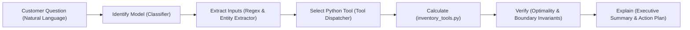

# Supply Chain Analytics Inventory Decision Agent

An intelligent, multi-model inventory decision agent that accepts natural-language supply chain questions, automatically identifies the appropriate quantitative model, extracts parameters, selects and executes pure Python analytical tools, verifies mathematical optimality, and produces executive-ready explanations with actionable operational guidance.

---

## Architecture Flow



The agent executes a deterministic 7-stage workflow:
1. **Customer Question**: Free-form natural-language input from inventory managers.
2. **Identify Model**: Multi-signal classification across 5 supported inventory models.
3. **Extract Inputs**: Robust parsing of units, intervals, currencies, percentages, and quantity discount schedules, with automatic time-unit normalization:
   - **Monthly demand**: Multiplied by 12 ($1,000\text{ units/month} \times 12 = 12,000\text{ units/year}$).
   - **Weekly demand**: Multiplied by 52 ($250\text{ units/week} \times 52 = 13,000\text{ units/year}$).
   - **Daily demand**: Multiplied by operating days ($40\text{ units/day} \times 250\text{ work days/year} = 10,000\text{ units/year}$, or $\times 365$ for calendar days).
   - **Quarterly demand**: Multiplied by 4 ($3,000\text{ units/quarter} \times 4 = 12,000\text{ units/year}$).
   - **Non-annual holding costs**: Automatically normalized to annual basis (e.g. $\$0.10/\text{unit/month} \times 12 = \$1.20/\text{unit/year}$), displaying the explicit calculation in Section 1 of the verification audit.
4. **Select Python Tool**: Maps the problem to the exact mathematical routine in `inventory_tools.py`.
5. **Calculate**: Pure Python numerical evaluation with high precision.
6. **Verify**: Automated invariant verification (first-order conditions, non-negativity, convex second derivatives, and inventory conservation).
7. **Explain**: Generates executive summaries, formula breakdowns, managerial trade-offs, and procurement actions.

---

## Supported Inventory Models

| # | Model | Decision Question | Core Invariant / Optimality Condition |
|---|---|---|---|
| **1** | **Economic Order Quantity (EOQ)** | *How much to order under constant demand to minimize holding + ordering costs?* | $AOC = AHC \iff \frac{D}{Q}S = \frac{Q}{2}H$ |
| **2** | **Quantity Discount Model** | *Which volume pricing tier minimizes total annual procurement + inventory costs?* | Evaluates feasible $EOQ_j$ vs tier price breaks $Q_j$ |
| **3** | **Safety Stock & Reorder Point (Continuous Review)** | *When should we reorder and how much buffer stock is needed under lead-time uncertainty?* | $ROP = \bar{d}\bar{L} + z\sigma_{DLT}$, where $\sigma_{DLT} = \sqrt{\bar{L}\sigma_d^2 + \bar{d}^2\sigma_L^2}$ |
| **4** | **Fixed-Period Review (Periodic Order-Up-To)** | *How high should base-stock level $S$ be when reviewing inventory every $R$ periods?* | Protection window $= R + L$; $S = \bar{d}(R+L) + z\sigma_d\sqrt{R+L}$; $q = \max(0, S - IP)$ |
| **5** | **Newsvendor Model (Single-Period Stochastic)** | *How many perishable/seasonal units should we procure facing uncertain demand?* | Critical Fractile $CR = \frac{C_u}{C_u + C_o} = \Phi(z^*)$; $Q^* = \mu + z^*\sigma$ |
| **6** | **Multicriteria Inventory Classification** | *How should SKUs be stratified across cycle count and service level policies?* | Weighted-score stratification from `stratification_tutorial.xlsx` with Module 3 policies |

---

## Multicriteria Inventory Classification (Methodology Stratification)

The application implements the exact bivariate weighted-score stratification methodology from `Inventory_Classification_Methodology.pdf` and course workbook (`stratification_tutorial.xlsx`), synthesizing **Sales ($)** (annual dollar volume) and **Hits** (annual order line pick frequency) into comprehensive inventory control policies.

### 1. Individual Criterion Ranking Brackets & Tie-Breaking
Each criterion is sorted descending—strictly preserving original row order on ties via `(-value, original_index)`—to calculate cumulative volume (`Cum`) and cumulative share (`Cum / Total`):
- **Class A**: $\text{Cumulative Share} < 0.60$ (top 60% of volume; top positive item always covers initial bracket)
- **Class B**: $0.60 \le \text{Cumulative Share} < 0.80$ (next 20% of volume)
- **Class C**: $0.80 \le \text{Cumulative Share} < 0.90$ (next 10% of volume)
- **Class D**: $\text{Cumulative Share} \ge 0.90$ (bottom 10%, plus non-positive items with $\$0.00$ sales or $0$ hits)

### 2. Rank-to-Score Points Conversion & Combined Weighted Score
Ranks are converted to numeric point values:
$$\text{Class A} = 4, \quad \text{Class B} = 3, \quad \text{Class C} = 2, \quad \text{Class D} = 1$$

The combined weighted score is computed with default weights of **0.65 for Sales** and **0.35 for Hits** (rounded to 6 decimal places to prevent floating-point drift):
$$\text{Combined Weighted Score} = 0.65 \times \text{Sales\_Score} + 0.35 \times \text{Hits\_Score}$$

Interactive sliders in Streamlit allow real-time tuning while automatically constraining the sum of weights to $1.00$.

### 3. Final Multicriteria Class Exact Thresholds & Module 3 Policies
The `Final_Class` (or `Final_Inventory_Class`) is assigned using the exact methodology thresholds:
- **Methodology Thresholds (Default)**:
  - $\text{Score} \ge 3.25 \rightarrow \mathbf{A}$ ($4.00 - 3.25$)
  - $\text{Score} \ge 2.50 \rightarrow \mathbf{B}$ ($3.24 - 2.50$)
  - $\text{Score} \ge 1.75 \rightarrow \mathbf{C}$ ($2.49 - 1.75$)
  - $\text{Score} < 1.75 \rightarrow \mathbf{D}$
- **Alternate Scale**:
  - $\text{Score} \ge 3.40 \rightarrow \mathbf{A}$
  - $\text{Score} \ge 2.80 \rightarrow \mathbf{B}$
  - $\text{Score} \ge 2.10 \rightarrow \mathbf{C}$
  - $\text{Score} < 2.10 \rightarrow \mathbf{D}$

| Final Multicriteria Class | Methodology Score Range | Alternate Score Range | Recommended Cycle Count Policy | Recommended Customer Service Level (CSL) Policy | Operational Focus & Disposition |
| :---: | :---: | :---: | :--- | :--- | :--- |
| **Class A** | $\ge 3.25$ | $\ge 3.40$ | **Cycle count every week** | **High CSL: 95%–98%** | Critical items: High velocity or revenue. Strict weekly physical count and tight safety stocks. |
| **Class B** | $2.50 \le \text{Score} < 3.25$ | $2.80 \le \text{Score} < 3.40$ | **Cycle count once a month** | **Medium CSL: 85%–90%** | Intermediate items: Moderate revenue or transaction frequency. Monthly cycle counts. |
| **Class C** | $1.75 \le \text{Score} < 2.50$ | $2.10 \le \text{Score} < 2.80$ | **Cycle count once a year** | **Low CSL: 70%–80%** | Low velocity items: Low dollar value or infrequent picks. Annual physical count. |
| **Class D** | $< 1.75$ | $< 2.10$ | **Do not count** | **No safety stock; donate, destroy, or discount** | Dead stock / obsolete items ($0 sales or 0 hits). No replenishment; liquidate or dispose. |

### 4. Required Classification Summary Table
The application displays the required portfolio distribution table:
| Final Class | Number of Items | Total Sales ($) |
| :---: | :---: | :---: |
| Class A | 2 | \$190,000.00 |
| Class B | 1 | \$18,000.00 |
| Class C | 1 | \$42,000.00 |
| Class D | 8 | \$42,800.00 |

### 5. Attached DataFrame Attributes
Every catalog SKU is enriched with structured stratification fields:
1. `Sales_Cum_Pct`
2. `Sales_Rank`
3. `Hits_Cum_Pct`
4. `Hits_Rank`
5. `Sales_Score`
6. `Hits_Score`
7. `Weighted_Score` (`Combined_Weighted_Score`)
8. `Final_Class` (`Final_Inventory_Class`)
9. `Cycle_Count_Policy`
10. `Safety_Stock_CSL_Policy`

---

## File Roles

- **[`streamlit_app.py`](file:///Users/tomasinahill/Downloads/Inventory%20Agent/streamlit_app.py)**: Modern Streamlit web application featuring natural-language question input, pre-loaded example problem buttons, 6-stage structured Analyst Verification Audit blocks, and an enterprise **CSV Inventory Data Upload & Analytics Dashboard** (dataset summary, multicriteria classification cards, policy reference tables, enriched classification table, calculated `inventory_value`, KPI metrics, and category-level breakdowns).
- **[`inventory_tools.py`](file:///Users/tomasinahill/Downloads/Inventory%20Agent/inventory_tools.py)**: Pure Python calculation engine implementing all 5 inventory models, statistical normal distributions (`NormalDist`, loss function $L(z)$), structured 6-stage Analyst Verification Audits, and **Multicriteria Inventory Classification** (`perform_multicriteria_classification`, `map_multicriteria_class`, `MODULE_3_POLICIES`).
- **[`BUG_FIX_VALIDATION_NOTES.md`](file:///Users/tomasinahill/Downloads/Inventory%20Agent/BUG_FIX_VALIDATION_NOTES.md)**: Detailed bug-fix validation records including currency-formatted string parsing in CSV ingestion.
- **[`inventory_agent.py`](file:///Users/tomasinahill/Downloads/Inventory%20Agent/inventory_agent.py)**: Orchestrator implementing the full pipeline (`Customer Question → Identify Model → Extract Inputs → Select Python Tool → Calculate → Verify → Explain`).
- **[`app.py`](file:///Users/tomasinahill/Downloads/Inventory%20Agent/app.py)**: CLI interface supporting interactive REPL mode, `--demo` mode showcasing all models, single-query mode (`--query`), and JSON export (`--json`).
- **[`tests/test_streamlit_app.py`](file:///Users/tomasinahill/Downloads/Inventory%20Agent/tests/test_streamlit_app.py)**: Unit and integration tests verifying Streamlit components, CSV ingestion, currency parsing, and Multicriteria Inventory Classification matrix logic and policy mappings.
- **[`tests/test_inventory_tools.py`](file:///Users/tomasinahill/Downloads/Inventory%20Agent/tests/test_inventory_tools.py)**: Comprehensive unit tests for analytical tools, statistical functions, and mathematical verification invariants.
- **[`requirements.txt`](file:///Users/tomasinahill/Downloads/Inventory%20Agent/requirements.txt)**: Python package dependencies (`streamlit`, `pandas`, `scipy`, `numpy`, `pydantic`, `pytest`, `pytest-cov`, `tabulate`, `colorama`).

---

## Quickstart & Usage

### 1. Launch Streamlit Web Application
```bash
streamlit run streamlit_app.py
# or using the run.sh launcher:
./run.sh streamlit
```

### 2. Run Automated Demonstration
```bash
python3 app.py --demo
```

### 3. Interactive Natural-Language REPL
```bash
python3 app.py
```
*Ask questions like:*
- *"Our annual demand is 12,000 units. Each order costs $50 to place, and holding cost is $2 per unit per year. What is our EOQ?"*
- *"A supplier offers volume discount: 1 to 499 units @ $10.00, 500 to 999 units @ $9.50, and 1000+ units @ $9.00. Annual demand is 4,000 units, order cost is $45, and annual holding rate is 20%. How much should we order?"*
- *"Daily demand averages 100 units with standard deviation of 15 units. Supplier lead time is 4 days. We need a 95% cycle service level. What should our safety stock and reorder point be?"*
- *"We review inventory every 14 days. Lead time is 7 days. Average demand is 50 units with std dev 8. Target service level is 98%. On hand we have 420 units and 100 on order. What is the order-up-to level and how much should we order?"*
- *"We sell winter jackets for $250 each. We buy them for $100. Any unsold jackets at the end of the season are sold at markdown for $40. Demand is normally distributed with mean 500 and std dev 80. How many jackets should we purchase?"*

### 3. Single Query Execution
```bash
python3 app.py --query 'Annual demand is 12000, order cost is $50, holding cost is $2. What is our EOQ?'
```

### 4. Machine-Readable JSON Output
```bash
python3 app.py --query 'Annual demand is 12000, order cost is $50, holding cost is $2. What is our EOQ?' --json
```

### 5. Running the Test Suite
```bash
python3 -m unittest discover -s tests -p "test_*.py" -v
```
